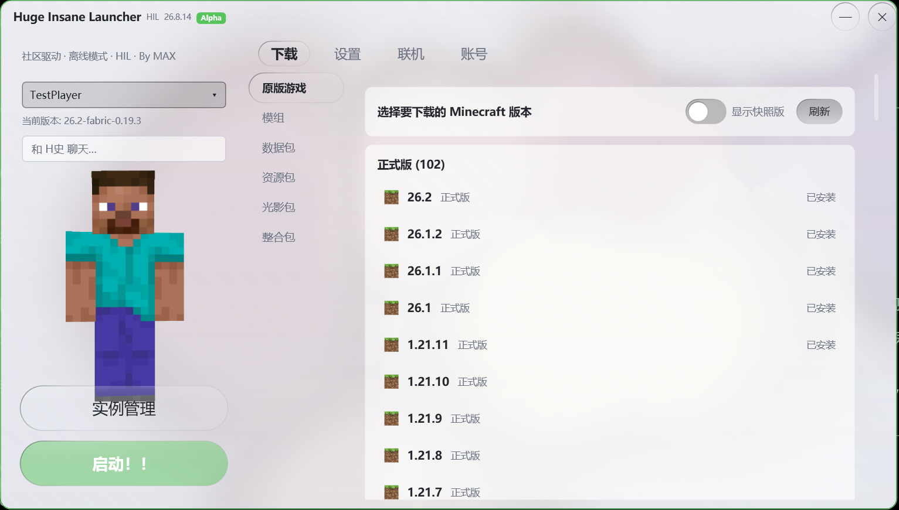

# Huge Insane Launcher (HIL)

> A **single-file, portable** Minecraft launcher for Windows — liquid-glass UI, an AI assistant,
> one-click servers and NAT-traversal multiplayer. Written entirely in C# + WPF with **zero
> third-party dependencies**; the build output is a single `.exe`.

[]()
[](LICENSE)
[]()

[中文文档](README.md) · [Features](#features) · [Build](#build-from-source)

---



## Features

- **Portable by design** — drop the exe anywhere; `.minecraft/` and `HugeInsaneLauncher/` are
  created next to it. Delete the folder to uninstall. No registry, no leftovers.
- **Versions & loaders** — vanilla, snapshots, Forge, NeoForge and Fabric; duplicate instances get
  a `#` suffix instead of overwriting.
- **Modrinth integration** — search and install mods, resource packs, shaders, modpacks and
  datapacks straight into an instance.
- **Instance management** — per-instance memory/JVM settings, mod toggles, saves, modpack export.
- **Accounts** — multiple offline profiles plus Yggdrasil / authlib-injector external login.
- **Multiplayer** — one-click Vanilla/Paper server with live console, a server-hall browser using
  the Server List Ping protocol, and the *Huge Tunnel*: a 6-character room code, Cloudflare
  Durable Object signalling, NAT hole punching and automatic relay fallback.
- **AI assistant "H史"** — DeepSeek or a built-in free relay; 16 registered tools covering
  resource search/install, game download/launch, memory/theme, server control, crash reading and
  repair. The model can only call tools — it never touches the file system or a shell.
- **Visuals** — live-backdrop liquid glass (8-ring seamless refraction), metaball slime wallpaper,
  a 3D Steve mascot, light/dark themes with automatic day-night switching, and a desktop float ball.

## Build from source

Requirements: Windows 10/11 and .NET Framework 4.x (preinstalled). Python 3 is optional.

```bat
taskkill /IM HugeInsaneLauncher.exe /F
cmd /c build.bat
python HugeInsaneLauncher\tools\merge_single.py 26.8.14
```

The compiler is the in-box `csc.exe`, so the source must stay within **C# 5** syntax
(no string interpolation, `?.`, `nameof`, expression-bodied members or tuples).

CI builds and publishes releases on `v*` tags — see
[.github/workflows/build.yml](.github/workflows/build.yml).

## Project layout

```
build.bat                     csc build script
HugeInsaneLauncher/src/       ~23k lines: core, ui/, ui/pages/, ai/
HugeInsaneLauncher/docs/      design docs
HugeInsaneLauncher/tools/     merge script, self-check, LAN agent, Cloudflare Worker
website/                      Cloudflare Pages site + AI relay
```

## Known issues

- Light-mode text ghosting on a few glass surfaces (version dropdown, top tabs, instance button);
  dark mode is unaffected.
- Windows only. Microsoft account login is not implemented yet.

## Disclaimer

Not affiliated with Mojang Studios or Microsoft. This repository contains no game assets, no Java
runtime and no credentials. You must own Minecraft to use it. Third-party notices are in
[NOTICE](NOTICE).

## License

[MIT](LICENSE) © 2026 Huge Insane Launcher contributors
