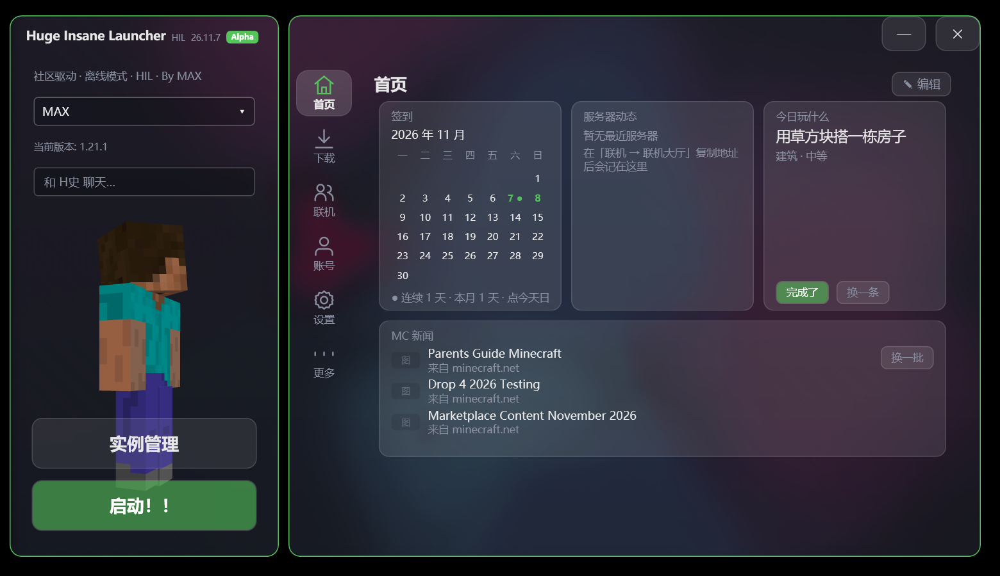

# Huge Insane Launcher

**一个 3.3 MB 的单文件 Minecraft 启动器**：双击即用，不装环境、不装依赖，离线也能开。

<p align="center">
  
</p>

---

## 特性

**启动与下载**

- 原版 / Forge / NeoForge / Fabric 一键安装，自动补齐对应 Java 运行时（按版本声明的 `javaVersion` 选，不靠猜）
- 重复下载同一版本自动落成 `1.21.1#`、`1.21.1##` 副本，互不干扰
- 模组 / 资源包 / 光影 / 整合包四大下载源，支持搜索与整合包实例

**界面**

- 三种皮肤：**流光**（液态玻璃）、**霜面**（磨砂）、**素底**，深浅两色
- 纵向舞台 / 经典横排两种布局，导航栏可拖拽排序、隐藏，`Shift+S` 随时偷看被隐藏的入口
- 悬浮球：下载进度、游戏运行状态实时显示
- 7 步新手引导：主题 → 布局 → 导航 → 游戏位置 → 下载 → 登录 → 完成

**首页与工具**

- 首页小部件：签到、今天玩什么、服务器动态、MC 新闻（直连 minecraft.net 原文）、公告，可拖动缩放
- 找乐子：小部件看板，拖动即重排，自动让位
- **种子地图**：村庄 / 海底神殿 / 林地府邸 / 前哨 / 远古城市 / 废弃传送门 / 要塞 / 出生点，分块缓存 + 分级缩放，点一下复制 `/tp` 指令
- **合成查询**：145 条配方，3×3 真实摆法，方块图标走原版模型等距渲染

**账号与联机**

- 离线模式、第三方 Yggdrasil（外置登录）、正版账号导入
- 联机：内置破墙 agent + 一键开服（Vanilla / Paper）

---

## 下载与使用

1. 从 [hugeinsane.pages.dev](https://hugeinsane.pages.dev) 下载 `HugeInsaneLauncher.exe`
2. 放到任意目录双击运行，首次启动会在同目录生成 `.minecraft/`（游戏文件）和 `HugeInsaneLauncher/`（配置）
3. 在「下载」页选版本安装，然后点「启动！！」

> 当前版本 **26.11.7 Alpha**。启动器会自动检查更新。

### 常见问题

| 问题 | 说明 |
|---|---|
| 启动时弹「Could not create the Java Virtual Machine」 | 多半是可用内存不够（不是 Java 装坏）。26.11.7 起启动前会提示并给出建议内存值 |
| 下载后又出现一个同名版本 `xxx#` | 这是副本机制，用于同版本多实例（不同模组/整合包），正常 |
| 正版（Microsoft）登录 | 暂未接入，需要 Azure 应用 ID；目前支持离线与第三方登录 |
| 新闻/公告加载失败 | 新闻直连 minecraft.net，网络不通时显示离线提示，稍后自动重试 |

---

## 从源码构建

要求：Windows + .NET Framework 4.x（系统自带 `csc`）。**没有 NuGet 依赖，没有 XAML，没有第三方库。**

```bat
build.bat
```

产物是根目录的 `HugeInsaneLauncher.exe`，内嵌资源包括：

- `Images/items.zip`：物品贴图
- `Images/blocks3d.zip`：预渲染的方块 3D 图标（没有 `.minecraft` 的机器也能显示）
- `tools/cubiomes.dll`：种子地图内核
- `tools/lan-agent/hil-lan-agent.jar`：联机破墙
- `Images/steve.png`、`Images/hil.ico`

单文件源码存档（用于归档/对照）：

```bat
python HugeInsaneLauncher\tools\merge_single.py 26.11.7
```

---

## 项目结构

```
HugeInsaneLauncher/
  src/                 启动器源码（C# 4.0 子集，UI 全代码构建）
    ui/                界面层：主窗口、导航、皮肤、动画、小部件
    ui/pages/          各页面：首页、下载、账号、设置、工具、找乐子…
  tools/               构建与开发工具（单文件合并、cubiomes 桥接、联机 agent）
  Images/              内嵌资源
website/               官网与发布产物（index.html / version.txt / exe）
回滚/                  历史版本单文件存档
promo/                 宣传片与字幕工程
```

---

## 已知限制

- 未接入 Microsoft 正版登录
- 种子地图结构与要塞基于 cubiomes 推算，和游戏内实际生成可能有细微差异
- 仅 Windows

---

## 反馈

- Issue：[github.com/MAXPR013/huge-insane-launcher/issues](https://github.com/MAXPR013/huge-insane-launcher/issues)
- 官网：[hugeinsane.pages.dev](https://hugeinsane.pages.dev)

## 致谢与声明

- 种子地图使用 [cubiomes](https://github.com/Cubitect/cubiomes)（MIT）
- 外置登录使用 [authlib-injector](https://github.com/yushijinhun/authlib-injector)（AGPL-3.0）
- 本项目与 Mojang / Microsoft 无关；Minecraft 是 Mojang 的商标。使用前请自备正版游戏账号
